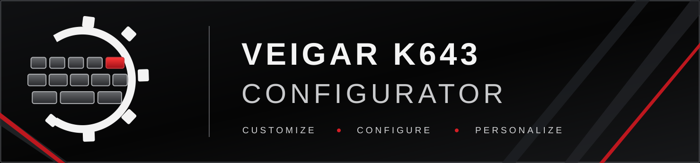

  

# Veigar K643 Configurator

**Unofficial configuration software for the Redragon Veigar K643**

Copyright (C) 2026 thwere

[English](#english) · [Русский](#русский)

---

## English

### Project status

This project is in an early experimental development stage. It is not yet a finished application, and no stable release is available.

### Purpose

Veigar K643 Configurator is an independent Windows application project focused on configuring and customizing the Redragon Veigar K643 keyboard.

The long-term goal is to provide a flexible alternative to the manufacturer's configuration software, with particular attention to RGB lighting and custom lighting effects.

### Currently verified in experiments

- The keyboard has been identified over USB (VID 258A, PID 0049).
- A custom C# test program has successfully sent temporary RGB frames to the keyboard.
- Individual RGB slots have been mapped experimentally to physical keys.
- Windows Raw Input has successfully detected physical key presses from the keyboard.

These are development experiments, not features of a released end-user application. Compatibility and behaviour must continue to be tested.

### Planned areas

- Per-key RGB lighting.
- Lighting profiles and presets.
- A layered lighting system combining static colours, animations and reactive effects.
- Frame-based animation editor.
- Painting colours directly on a visual keyboard layout, as well as assigning colours by pressing physical keys.
- Audio-reactive lighting.
- Lighting reactions to key presses.
- Further keyboard configuration features, subject to protocol research and device capabilities.

### Target platform

- Windows 10 x64.
- Windows 11 x64 (planned compatibility; testing is required).
- Redragon Veigar K643 connected through USB.

### Independence notice

This is an unofficial community-developed project. It is not affiliated with, endorsed by, or supported by Redragon. Redragon and Veigar are names and/or marks of their respective owners. The project does not claim ownership of the keyboard or its firmware.

### License

The project source code is licensed under the GNU General Public License version 3 or (at your option) any later version. See the [LICENSE](LICENSE) file for the complete license text.

No warranty is provided. The software is experimental and should not be relied upon for critical use.

---

## Русский

### Статус проекта

Проект находится на ранней экспериментальной стадии разработки. Готового приложения и стабильных публичных релизов пока нет.

### Назначение

Veigar K643 Configurator — независимый проект Windows-приложения для настройки и персонализации клавиатуры Redragon Veigar K643.

Долгосрочная цель — создать гибкую альтернативу фирменному ПО производителя, уделив особое внимание RGB-подсветке и пользовательским световым эффектам.

### Что уже проверено в экспериментах

- Клавиатура определена по USB (VID 258A, PID 0049).
- Тестовая программа на C# успешно отправляла клавиатуре временные RGB-кадры.
- Соответствие отдельных RGB-слотов физическим клавишам экспериментально восстановлено.
- Windows Raw Input успешно распознавал физические нажатия клавиш этой клавиатуры.

Это результаты исследовательских экспериментов, а не функции готового пользовательского приложения. Совместимость и поведение ещё предстоит проверять.

### Планируемые направления

- Индивидуальная RGB-подсветка клавиш.
- Профили и предустановки подсветки.
- Многослойная система подсветки, объединяющая статичные цвета, анимации и реактивные эффекты.
- Редактор покадровой анимации.
- Рисование цветов на визуальной модели клавиатуры и назначение цветов нажатием физических клавиш.
- Реакция подсветки на звук.
- Реакция подсветки на нажатия клавиш.
- Другие функции настройки клавиатуры по мере изучения протокола и возможностей устройства.

### Целевые платформы

- Windows 10 x64.
- Windows 11 x64 (совместимость планируется, требуется тестирование).
- Redragon Veigar K643, подключённая по USB.

### Независимость проекта

Это неофициальный независимый проект сообщества. Он не связан с Redragon, не одобрен и не поддерживается компанией Redragon. Названия Redragon и Veigar принадлежат соответствующим правообладателям. Проект не заявляет прав на клавиатуру или её прошивку.

### Лицензия

Исходный код проекта распространяется под GNU GPL версии 3 или, по выбору пользователя, любой более поздней версии. Полный текст лицензии находится в файле [LICENSE](LICENSE).

Гарантии не предоставляются. Программа находится в экспериментальной разработке и не предназначена для критически важных задач.
