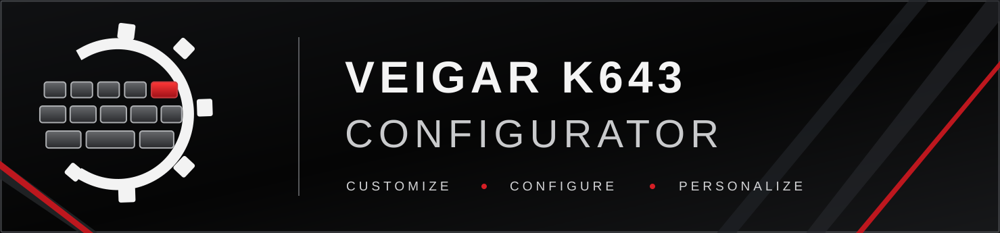

  

# Veigar K643 Configurator

Неофициальная программа настройки клавиатуры Redragon Veigar K643.

Copyright (C) 2026 thwere

## Статус проекта

Проект находится на экспериментальной стадии разработки. Первая расширенная alpha-сборка включает RGB Studio, настройку произвольного цвета и локальные профили подсветки.

## Возможности текущей сборки

- Автоматическое обнаружение проверенного HID-интерфейса Veigar K643 (VID 258A / PID 0049, MI_01 / Col08).
- Управление общей RGB-подсветкой всех 126 LED-слотов.
- Ползунки каналов R, G и B.
- Ввод цвета в HEX-формате из шести символов.
- Регулировка общей яркости и предпросмотр итогового цвета.
- Восемь быстрых цветовых пресетов и команда выключения подсветки.
- Сохранение и загрузка локальных JSON-профилей.
- Отправка одного HID-отчёта в фоновом потоке без искусственной трёхсекундной серии повторов.

## Проверка оборудования

Первая WPF-сборка успешно зажгла все клавиши при пользовательском тестировании. Расширенный редактор, сохранение профилей и однократная отправка HID-отчёта входят в v0.2.0-alpha и требуют дополнительной проверки на физической клавиатуре.

Текущий интерфейс управляет общей одноцветной подсветкой. Экспериментальная карта соответствия LED-слотов физическим клавишам и обнаружение нажатий через Windows Raw Input пока не интегрированы в пользовательский интерфейс.

## Что уже проверено в экспериментах

- Клавиатура определена по USB (VID 258A, PID 0049).
- Тестовая программа на C# успешно отправляла клавиатуре временные RGB-кадры.
- Соответствие отдельных RGB-слотов физическим клавишам экспериментально восстановлено.
- Windows Raw Input успешно распознавал физические нажатия клавиш этой клавиатуры.

## Дальнейшие направления

- Проверенный редактор индивидуальной подсветки клавиш и визуальная модель клавиатуры.
- Профили с несколькими слоями подсветки.
- Анимации и реактивные эффекты.
- Покадровый редактор анимаций.
- Реакция на звук и нажатия клавиш.
- Дополнительные функции по мере исследования протокола.

## Целевые платформы

- Windows 10 x64.
- Windows 11 x64 (требуется тестирование).
- Redragon Veigar K643, подключённая по USB.

## Независимость проекта

Это неофициальный независимый проект сообщества. Он не связан с Redragon, не одобрен и не поддерживается компанией Redragon. Названия Redragon и Veigar принадлежат соответствующим правообладателям.

## Лицензия

Исходный код распространяется под GNU GPL версии 3 или, по выбору пользователя, любой более поздней версии. Полный текст находится в файле [LICENSE](LICENSE).

Гарантии не предоставляются. Программа находится в экспериментальной разработке и не предназначена для критически важных задач.
